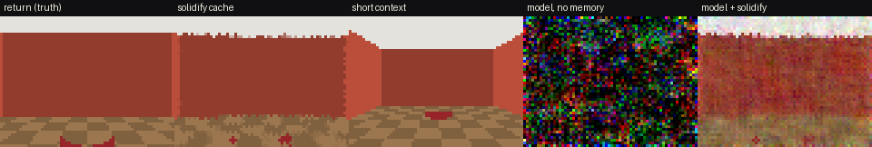

# Prime Graphic AI Engine

The engine remembers. The model renders.

Phase 0 is a Colab-ready prototype of that split. A deterministic house owns the camera, the doors, and a vase you can knock over. A per-room voxel cache (**Solidify**) stores what was seen. A small action-conditioned diffusion model draws the next frame. When you leave through three rooms and come back, the foyer is the same room, and the on-screen state hash matches the hash locked after the edit.

This is the toy in [the architecture plan](docs/engine-plan.md), not the 1.3B real-time Runner. The plan's speeds on an RTX 5060 Ti are estimates until they are measured on that card.

[](https://colab.research.google.com/github/AaronGrace978/Prime-Graphic-Ai-Engine/blob/cursor/phase0-solidify-prototype-2865/notebooks/phase0_solidify.ipynb)

## The Return

Measured on CPU, 64×48, 120 training steps, 1.18M parameters:

| | PSNR vs return frame | Perceptual distance (lower is better) |
|---|---|---|
| Solidify cache render | 20.3 dB | 0.019 |
| Model conditioned on the cache | 20.0 dB | 0.030 |
| Cache + consistency guard | 19.7 dB | 0.031 |
| Short context (frame from another room) | 14.2 dB | 0.083 |
| Model with no memory | 8.0 dB | 0.276 |

The state hash is `38926bdb63b7e7a4` both when the vase is locked toppled and when the camera comes back. It is not the hash from before the edit.



## Run locally

```bash
python3 -m pip install -r requirements.txt
python3 -m pip install torch --index-url https://download.pytorch.org/whl/cpu
python3 -m prime_engine.demo --steps 120 --out media
python3 -m unittest tests.test_return
```

`--steps` is the training budget. Geometry tests do not train a model. They check the hash, the portals, and that the cache render matches the room on revisit.

## What is in the repo

| Path | Role |
|---|---|
| `prime_engine/world.py` | Six-room house, pinhole RGB-D renderer, scripted leave-and-return |
| `prime_engine/schema.py` | Section 2.3 frame record and `state_hash` |
| `prime_engine/solidify.py` | Cells, voxel cache, pose-indexed keyframes, guide render, hot/warm/cold tag |
| `prime_engine/model.py` | Toy conditional diffusion Runner and the consistency guard |
| `notebooks/phase0_solidify.ipynb` | Same demo on Colab |
| `runtime/` | Reserved for the C++/Vulkan runtime. Not built in this phase. |
| `docs/engine-plan.md` | Full roadmap, licenses, and the decisions still open |

Each frame stores RGB, forward depth, instance id, camera intrinsics, 6DoF pose, action bitmask, mouse dx/dy, cell id, whether a portal was crossed, the prop state, and the state hash. Episodes round-trip through `save_episode` / `load_episode` (`.npz`).

Solidify locks a cell after it has been scanned. A later visit renders that cache instead of asking the model to remember the room. Toppling the vase drops that object's surfels, the cell re-locks, and the hash changes. Streaming tier (hot / warm / cold) is tracked from the doorway graph and is not part of the hash.

The fingerprint is BLAKE2s from the Python standard library. The production hash in the plan is BLAKE3. Same job, no extra package.

## Licenses

Code in this repository is MIT. See `LICENSE`.

The Phase 0 model is trained from scratch on frames rendered here. No third-party weights are downloaded. NumPy is BSD, Pillow is HPND, PyTorch is BSD. Godot 4 and CC0 art, which the plan uses for the real capture set, are not vendored in this prototype. The house is procedural.

Do not ship Hunyuan weights, Depth Anything Base/Large/Giant, or Matrix-Game checkpoints trained on commercial games. The plan's license map is the list to follow when the Runner moves to Wan2.1-1.3B.

## Next

Phase 1 replaces this toy network with a larger RGB-D model trained on captured play. The native runtime stays out of the frame path until that model is real-time. Decisions still open (Runner base, Godot vs Unreal, Anchored vs Dream as the product) are listed at the end of the plan.
